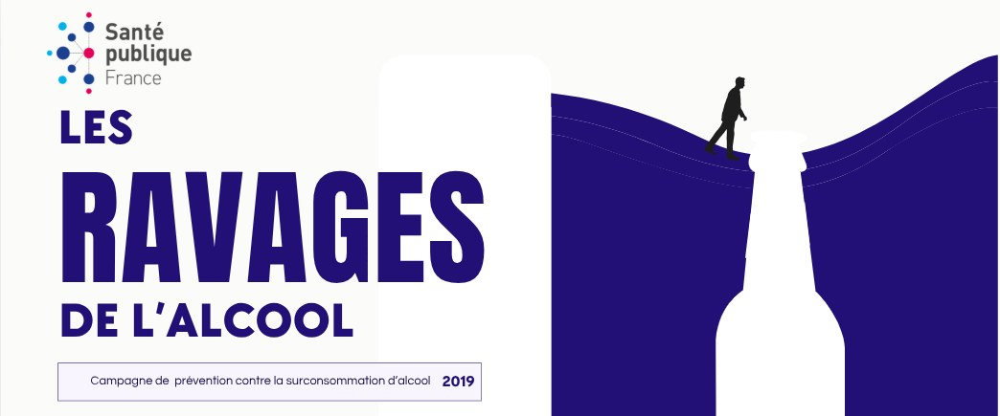

[← Projets](projets.qmd){.lien}

::: entete
::: bloc
[2024 – 2025 · Projet de L3 SPMOS · travail de groupe (4 étudiants)]{.date}

# Analyse d'une campagne de prévention contre les ravages de l'alcool

[Étude de la campagne « Ravages » de Santé publique France (2019)]{.discret}

[Projet de groupe · 4 personnes]{.pastille .important}
:::
:::

::: intro
Ce projet universitaire portait sur une campagne nationale de prévention contre la surconsommation d'alcool. Nous avons étudié ses objectifs, ses publics cibles, ses messages et ses supports de communication, ainsi que les résultats obtenus.
:::

{.photo fig-alt="Diapositive de titre : Les ravages de l'alcool, campagne de prévention de Santé publique France, 2019"}

## Problématique

Comment [sensibiliser efficacement la population aux risques liés à la consommation d'alcool]{.surligne} et encourager une évolution durable des comportements ?

## Ce que nous avons fait

::: {.grille .competences}
::: carte
### Comprendre le contexte

Étude des enjeux de [santé publique]{.surligne} liés à la consommation d'alcool.
:::

::: carte
### Analyser la campagne

Analyse de ses [objectifs]{.surligne}, de ses [publics cibles]{.surligne} et de ses [messages de prévention]{.surligne}.
:::

::: carte
### Évaluer

Étude des [résultats]{.surligne}, des points forts et des limites de la campagne, avec une [analyse SWOT]{.surligne} pour repérer les axes d'amélioration.
:::

::: carte
### Proposer des améliorations

Nous avons imaginé une [application mobile de suivi de consommation]{.surligne}, des [campagnes digitales adaptées aux jeunes]{.surligne} et des [dispositifs de sensibilisation immersifs]{.surligne}.
:::
:::

## Compétences mobilisées

[Recherche documentaire]{.pastille} [Analyse et synthèse]{.pastille} [Santé publique]{.pastille} [Prévention]{.pastille} [Analyse SWOT]{.pastille} [Rédaction]{.pastille} [Travail en équipe]{.pastille}

## Livrable

Rapport universitaire de 29 pages.

::: boutons
[Télécharger le rapport (PDF)](rapports/Rapport_campagne_prevention_alcool.pdf){.bouton download=""}
:::
