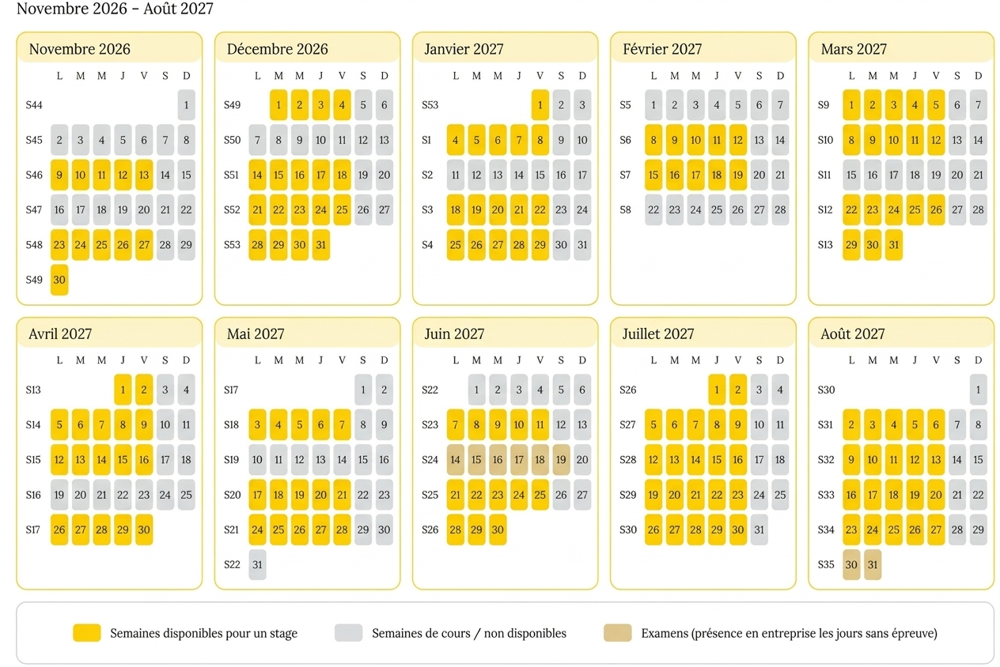
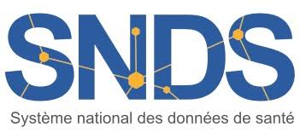
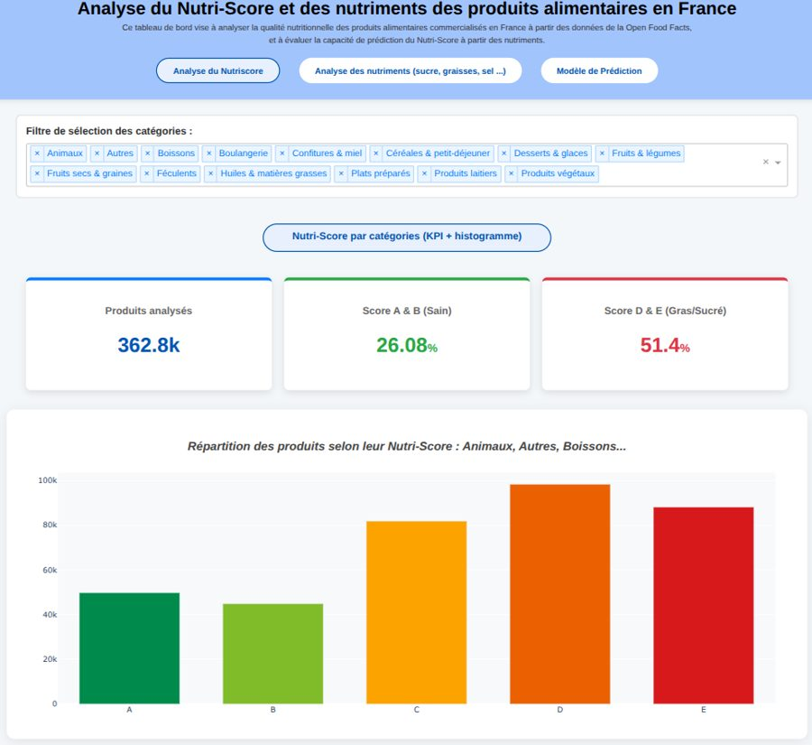
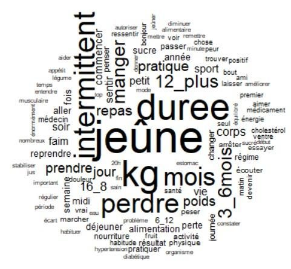

::: entete-accueil
::: bloc-titre
# Portfolio de Selma El Fagrouchi

::: grand-texte
Étudiante en 2^e^ année de Master Data Science en Santé\
Université de Lille · ILIS
:::
:::

{.logo-univ fig-alt="UFR3S ILIS, Université de Lille"}
:::

::: recherche
[Je recherche un stage en data science / biostatistiques / recherche, dans le domaine de la santé]{.titre-recherche}

- Stage rémunéré de 105 jours travaillés (environ 5 mois, sans compter les semaines de cours)
- Début possible à partir de novembre 2026, et au plus tard le 19 mars 2027
- Stage alterné avec mes cours : 1 à 2 semaines de cours par mois jusqu'en juin, puis disponible à temps plein à partir de juin

**Exemple :** si je commence le 1er janvier 2027, je termine le [21 juillet 2027]{.surligne}. [(105 jours = 100 jours travaillés + 5 jours de marge pour les jours fériés.)]{.discret}

Voir mon calendrier de cours

{.photo fig-alt="Calendrier de disponibilité de novembre 2026 à août 2027"}

:::

[R]{.pastille} [SQL]{.pastille} [Python]{.pastille} [Statistiques]{.pastille} [Power BI]{.pastille} [Excel]{.pastille} [R Shiny]{.pastille} [Git / GitHub]{.pastille} [Machine learning]{.pastille} [Tests statistiques]{.pastille} [Régression]{.pastille} [ACP]{.pastille} [Anova]{.pastille} [Séries temporelles]{.pastille} [Arbres de décision]{.pastille} [XGBoost]{.pastille} [LightGBM]{.pastille} [Web scraping]{.pastille} [Hopital Manager]{.pastille} [SNDS]{.pastille} [CRISP-DM]{.pastille} [Analyse textuelle]{.pastille}

[Voir mes projets](projets.qmd){.bouton} [Télécharger mon CV](rapports/CV_Selma_El_Fagrouchi.pdf){.bouton .contour download=""} [Me contacter](contact.qmd){.bouton .contour}

## Expérience professionnelle

::: {.carte .grande}
[Mars – août 2026 · 5 mois]{.date}

### Stage Data Scientist · Groupe hospitalier AHNAC

Prédiction des temps d'attente aux urgences de 3 établissements, avec visualisation dans un tableau de bord R Shiny et une application R Shiny Mobile.

[R]{.pastille} [SQL]{.pastille} [Machine learning]{.pastille} [R Shiny]{.pastille} [CRISP-DM]{.pastille}

{.photo fig-alt="Écran du tableau de bord affiché en salle d'attente"}

[Voir le détail →](stage-ahnac.qmd){.lien .lien-carte}
:::

## Projets étudiants

::: {.carte .grande}
[2026 – en cours · Mémoire de Master]{.date}

### [Mémoire]{.memoire-gros}analyse temporelle des hospitalisations pour tentatives de suicide en lien avec les conditions météorologiques

Mémoire de Master 2, à partir des données du SNDS et de Météo-France.

[SNDS]{.pastille} [Météo-France]{.pastille} [Séries temporelles]{.pastille}

::: logos-ligne
{fig-alt="Logo SNDS"}
{fig-alt="Logo Météo-France"}
:::

[Voir le détail →](memoire.qmd){.lien .lien-carte}
:::

::: grille
::: {.carte}
[2026 · Projet de groupe]{.date}

### Analyse du Nutri-Score et des nutriments des produits alimentaires en France

Projet de groupe (5 étudiants) : analyse des nutriments à partir d'Open Food Facts et tableau de bord interactif.

[Python]{.pastille} [Dash]{.pastille} [Plotly]{.pastille} [Régression logistique]{.pastille} [Nettoyage de données]{.pastille}

{.photo fig-alt="Tableau de bord Nutri-Score"}

[Voir le détail →](nutri-score.qmd){.lien .lien-carte}
:::

::: {.carte}
[2024 – 2025 · Projet de groupe]{.date}

### Le jeûne intermittent : témoignages sur les réseaux sociaux et littérature scientifique

Projet de groupe (4 étudiants) : analyse textuelle de 56 témoignages avec IRaMuTeQ.

[IRaMuTeQ]{.pastille} [Analyse textuelle]{.pastille} [Collecte de données]{.pastille}

{.photo fig-alt="Nuage de mots"}

[Voir le détail →](jeune-intermittent.qmd){.lien .lien-carte}
:::
:::
