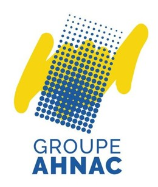
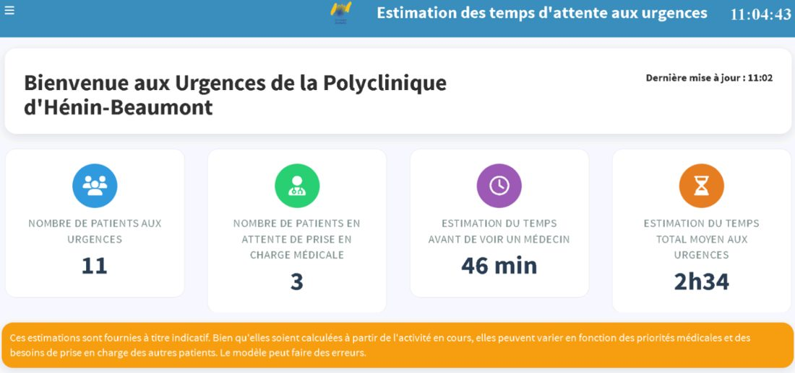
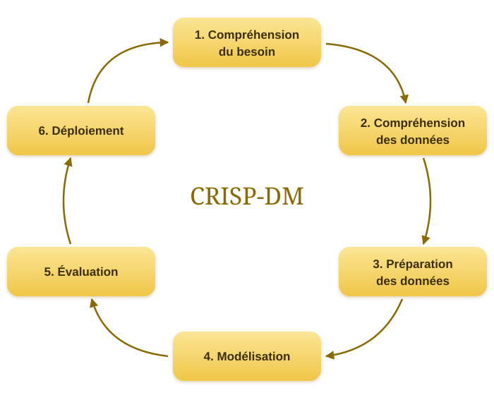
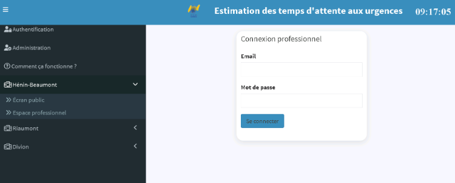
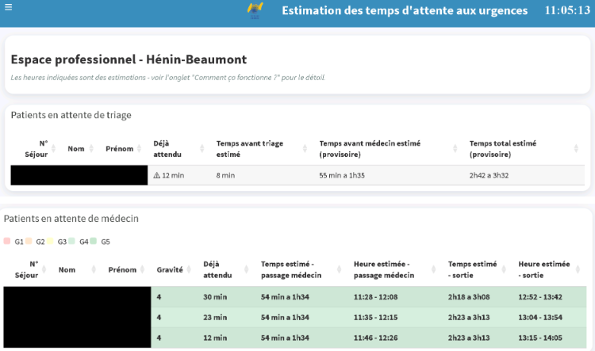
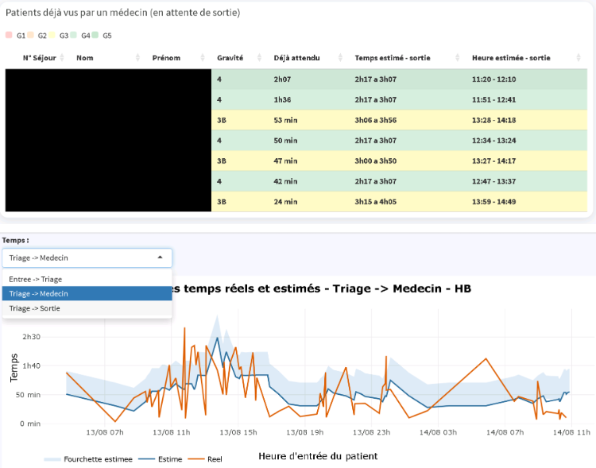
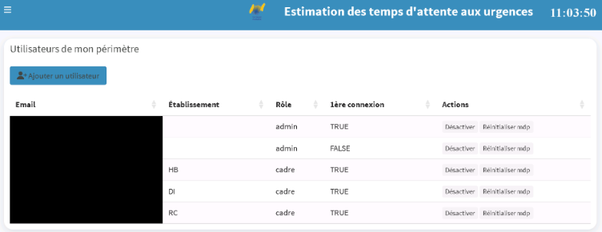
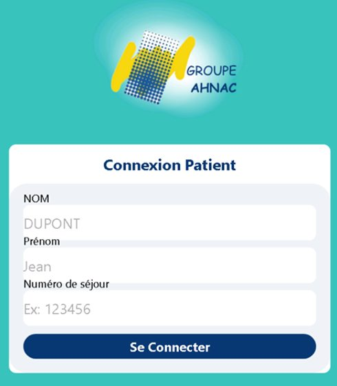
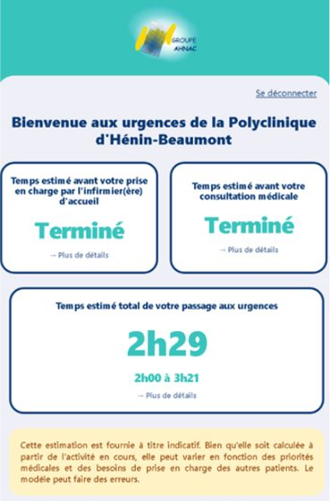

[← Projets](projets.qmd){.lien}

::: {.entete}

{.logo fig-alt="Logo du Groupe AHNAC"}

::: {.bloc}

::: {.date}

Mars – août 2026 · 5 mois

:::

# Stage Data Scientist · Groupe hospitalier AHNAC

::: {.discret}

Service transformation, Hôpital de Riaumont

:::

:::

:::

::: {.intro}

Prédiction des temps d'attente aux urgences de [3 établissements]{.surligne}, avec visualisation dans un [tableau de bord R Shiny]{.surligne} et une [application R Shiny Mobile]{.surligne}.

:::

{.photo fig-alt="Écran du tableau de bord affiché en salle d'attente"}

::: {.chiffres}

::: {.chiffre}

[3]{.nombre} hôpitaux

:::

::: {.chiffre}

[200 000]{.nombre} séjours analysés

:::

::: {.chiffre}

[7]{.nombre} modèles comparés

:::

:::

## Un projet mené de A à Z

J'ai réalisé [tout le projet, de l'extraction des données jusqu'au déploiement]{.surligne}, en suivant la méthode [CRISP-DM]{.surligne}.

::: {.cercle}

{fig-alt="Les six étapes de la méthode CRISP-DM"}

:::

## Ce que j'ai appris

::: {.grille .competences}

::: {.carte}

{.logo-hm fig-alt="Logo Hopital Manager"}

### Données de santé

J'ai extrait les données du logiciel Hopital Manager avec [SQL depuis R]{.surligne}, en retrouvant les bonnes tables parmi environ 1 300. J'ai ensuite nettoyé [plus de 4 millions de mouvements de patients]{.surligne} pour calculer les temps d'attente.

:::

::: {.carte}

### Modélisation

J'ai comparé [7 modèles]{.surligne}, des plus simples (moyennes, régressions) aux plus avancés ([XGBoost et LightGBM]{.surligne}). J'ai appris à choisir les variables utiles, à régler les modèles et à les évaluer de façon fiable, sur des données plus récentes que celles de l'entraînement.

:::

::: {.carte}

### Développement R Shiny

J'ai créé un [tableau de bord R Shiny]{.surligne} pour les soignants et un [prototype d'application mobile]{.surligne} pour les patients.

:::

::: {.carte}

### Sécurité et RGPD

Les soignants doivent [se connecter]{.surligne}, avec des droits différents selon leur rôle (administrateur, cadre ou soignant). L'écran affiché en salle d'attente ne montre [aucun nom de patient]{.surligne}.

:::

::: {.carte}

### Déploiement

Les calculs se lancent [automatiquement toutes les 10 minutes]{.surligne}. J'ai préparé l'installation sur un serveur interne et rédigé la documentation pour le service informatique.

:::

::: {.carte}

### Travail avec le terrain

J'ai échangé avec les [cadres des urgences des 3 hôpitaux]{.surligne} et avec le service informatique, pour vérifier les données et comprendre le fonctionnement des urgences.

:::

:::

## Packages R utilisés

::: {.paquets}

::: {.paquet}

`shinydashboard` [tableau de bord]{.description}

:::

::: {.paquet}

`shinymanager` [authentification des professionnels, gestion des rôles]{.description}

:::

::: {.paquet}

`shinyMobile` [application mobile pour les patients]{.description}

:::

::: {.paquet}

`data.table` [jointures non équi, indicateurs de flux]{.description}

:::

::: {.paquet}

`xgboost` [modèle de gradient boosting]{.description}

:::

::: {.paquet}

`lightgbm` [modèle de gradient boosting]{.description}

:::

::: {.paquet}

`ggplot2` [graphiques estimé contre réel]{.description}

:::

::: {.paquet}

`RODBC` [connexion à la base Hopital Manager]{.description}

:::

:::

## Le tableau de bord en images

::: {.galerie .galerie-large}
{.photo fig-alt="Page de connexion professionnelle du tableau de bord"}

{.photo fig-alt="Espace professionnel de l'hôpital d'Hénin-Beaumont"}

{.photo fig-alt="Graphique des temps estimés et réels"}

{.photo fig-alt="Page d'administration des comptes utilisateurs"}
:::

[Les noms, prénoms et numéros de séjour des patients, ainsi que les adresses e-mail, sont masqués.]{.discret}

## L'application mobile pour les patients

::: {.deux}

{fig-alt="Connexion patient"}{fig-alt="Estimations affichées au patient"}

:::

::: {.discret}

Prototype accessible par QR code : chaque patient ne voit que sa propre estimation.

:::
