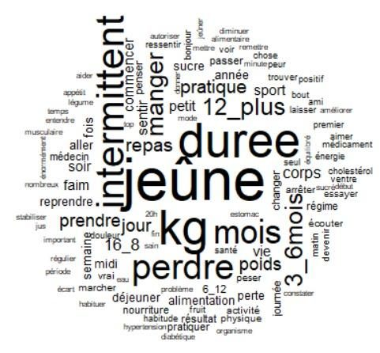
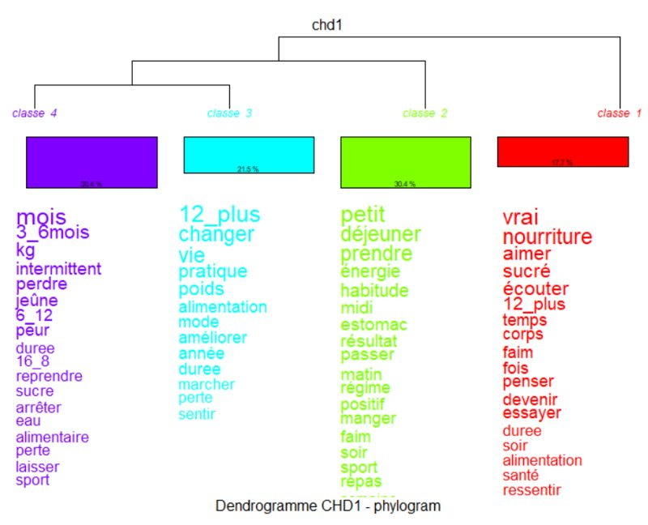
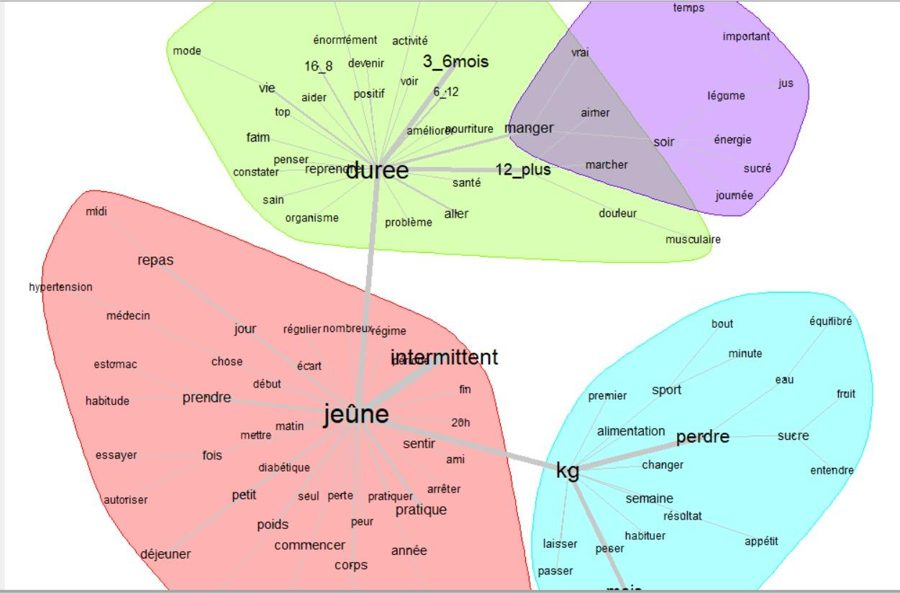
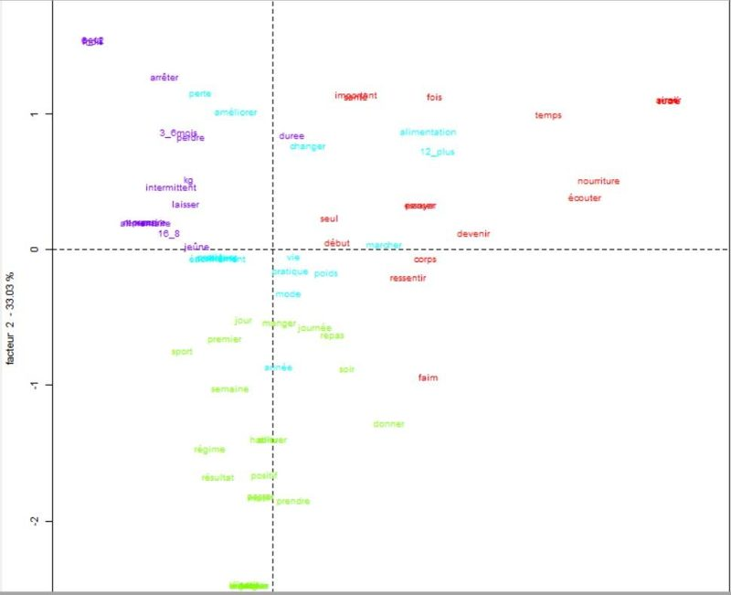

[← Projets](projets.qmd){.lien}

::: {.entete}

{.logo fig-alt="Logo IRaMuTeQ" width=170px}

::: {.bloc}

::: {.date}

Année 2024 – 2025 · Projet de L3 SPMOS · travail de groupe (4 étudiants)

:::

# Le jeûne intermittent : témoignages sur les réseaux sociaux et littérature scientifique

::: {.discret}

Analyse textuelle avec le logiciel IRaMuTeQ

:::

[Projet de groupe · 4 personnes]{.pastille .important}

:::

:::

::: {.intro}

Question : [les témoignages publiés sur les réseaux sociaux reflètent-ils ce que dit la science]{.surligne} sur les effets du jeûne intermittent ?

:::

{.photo fig-alt="Nuage de mots des témoignages"}

::: {.chiffres}

::: {.chiffre}

[56]{.nombre} témoignages analysés

:::

::: {.chiffre}

[4]{.nombre} plateformes (YouTube, TikTok, Instagram, FastBuddy)

:::

::: {.chiffre}

[4]{.nombre} classes thématiques

:::

:::

## Ce que nous avons fait

::: {.grille .competences}

::: {.carte}

### Collecter les témoignages

Nous avons rassemblé [56 témoignages]{.surligne} dans un Google Sheet, après un test sur 17. Des critères d'inclusion et d'exclusion ont servi à choisir des témoignages comparables (pratique depuis plus de 3 mois, récit à la première personne…).

:::

::: {.carte}

### Préparer les textes

Nettoyage des textes : fautes, caractères parasites, harmonisation des mots (« kilo » et « kg » par exemple), pour que le logiciel les lise correctement.

:::

::: {.carte}

### Analyser avec IRaMuTeQ

[Nuage de mots]{.surligne}, [classification hiérarchique]{.surligne} en 4 classes, [graphe de similitude]{.surligne} et [analyse factorielle des correspondances]{.surligne}, avec la durée de pratique en trois tranches.

:::

::: {.carte}

### Comparer à la littérature

Nous avons confronté les résultats aux études scientifiques sur la perte de poids, le métabolisme et les risques du jeûne.

:::

:::

## Ce que nous avons observé

Les témoignages parlent surtout de [perte de poids, de durée de pratique et de ressenti]{.surligne}, ce qui rejoint la littérature. Les pratiques courtes (3 à 6 mois) mettent en avant des résultats visibles. Les pratiques longues (plus de 12 mois) parlent plutôt d'écoute de soi et de rapport à la nourriture. Notre conclusion : le jeûne intermittent n'est ni une solution miracle, ni dangereux en soi, il doit être adapté à chaque personne.

## Les analyses

::: {.galerie}

{.photo fig-alt="Dendrogramme"}

{.photo fig-alt="Graphe de similitude"}

{.photo fig-alt="Analyse factorielle des correspondances"}

:::

::: {.boutons}

[Télécharger le rapport (PDF)](rapports/Rapport_jeune_intermittent.pdf){.bouton download=""}

:::
