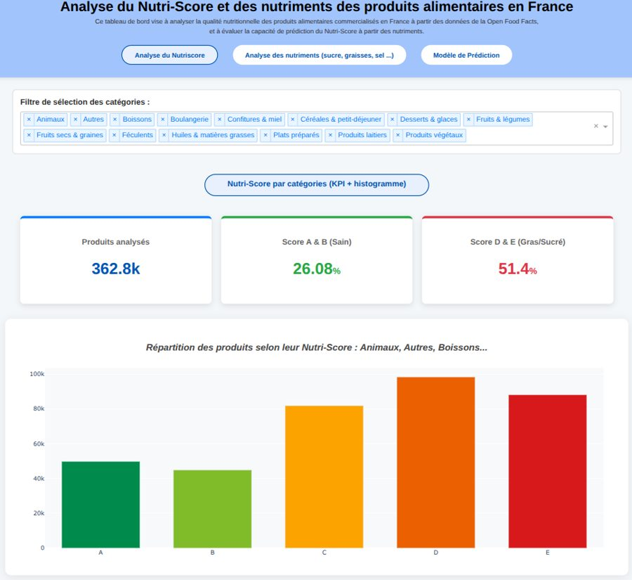

[← Projets](projets.qmd){.lien}

::: {.entete}

::: {.bloc}

::: {.date}

2026 · Projet de Master 1 Data Science en Santé · travail de groupe (5 étudiants)

:::

# Analyse du Nutri-Score et des nutriments des produits alimentaires en France

::: {.discret}

À partir des données Open Food Facts · tableau de bord interactif en Python

:::

[Projet de groupe · 5 personnes]{.pastille .important}

:::

:::

::: {.intro}

Question : [comment l'analyse des nutriments permet-elle d'expliquer les différences de Nutri-Score]{.surligne} entre les produits ? L'objectif était de créer un outil que tout le monde peut comprendre, même sans connaissances en nutrition.

:::

{.photo fig-alt="Tableau de bord Nutri-Score, page d'analyse par catégories"}

::: {.chiffres}

::: {.chiffre}

[1,2 M]{.nombre} de produits

:::

::: {.chiffre}

[\~250]{.nombre} variables

:::

::: {.chiffre}

[3]{.nombre} pages interactives

:::

:::

## Ce que nous avons fait

::: {.grille .competences}

::: {.carte}

### Préparer les données

La base d'origine pesait environ [12 Go]{.surligne}. Nous l'avons nettoyée sur Google Colab : valeurs manquantes, taux de nutriments impossibles (plus de 100 g pour 100 g) et séparation en plusieurs fichiers plus légers.

:::

::: {.carte}

### Créer nos propres catégories

La base contenait environ 200 catégories très différentes, en français et en anglais. Nous avons écrit un [dictionnaire de mots-clés]{.surligne} et l'avons amélioré en 8 tours, pour que les produits soient répartis dans des familles claires (boissons, produits laitiers, féculents…).

:::

::: {.carte}

### Construire un tableau de bord

Trois pages : l'analyse du [Nutri-Score par catégorie]{.surligne}, l'analyse des [nutriments]{.surligne} (sucre, graisses, sel, fibres, protéines) et un [modèle de prédiction]{.surligne} du Nutri-Score.

:::

::: {.carte}

### Prédire le Nutri-Score

Environ 60 % des produits n'ont pas de Nutri-Score. Nous avons entraîné une [régression logistique]{.surligne} qui l'estime à partir des valeurs nutritionnelles saisies par l'utilisateur.

:::

::: {.carte}

### Mettre l'outil en ligne

Nous avons déployé l'application sur [Render]{.surligne} et partagé le code sur [GitHub]{.surligne}, avec des instructions pour refaire les analyses.

:::

:::

## Ce que nous avons observé

Le [sucre, le sel et les graisses saturées]{.surligne} expliquent une grande partie des mauvais Nutri-Scores. À l'inverse, les produits peu transformés (fruits et légumes, féculents, produits végétaux) sont les mieux notés. Le Nutri-Score est surtout utile pour comparer des produits d'une même catégorie.

## Outils utilisés

[Python]{.pastille}[pandas]{.pastille}[numpy]{.pastille}[Dash]{.pastille}[Plotly]{.pastille}[scikit-learn]{.pastille}[joblib]{.pastille}[Google Colab]{.pastille}[GitHub]{.pastille}[Render]{.pastille}[R (exploration)]{.pastille}

::: {.boutons}

[Télécharger le rapport (PDF)](rapports/Rapport_Nutri-Score.pdf){.bouton download=""}

:::
