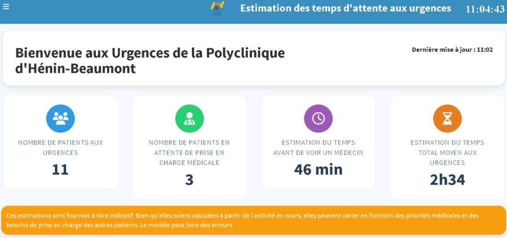
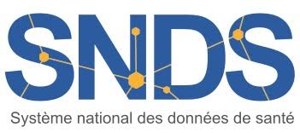
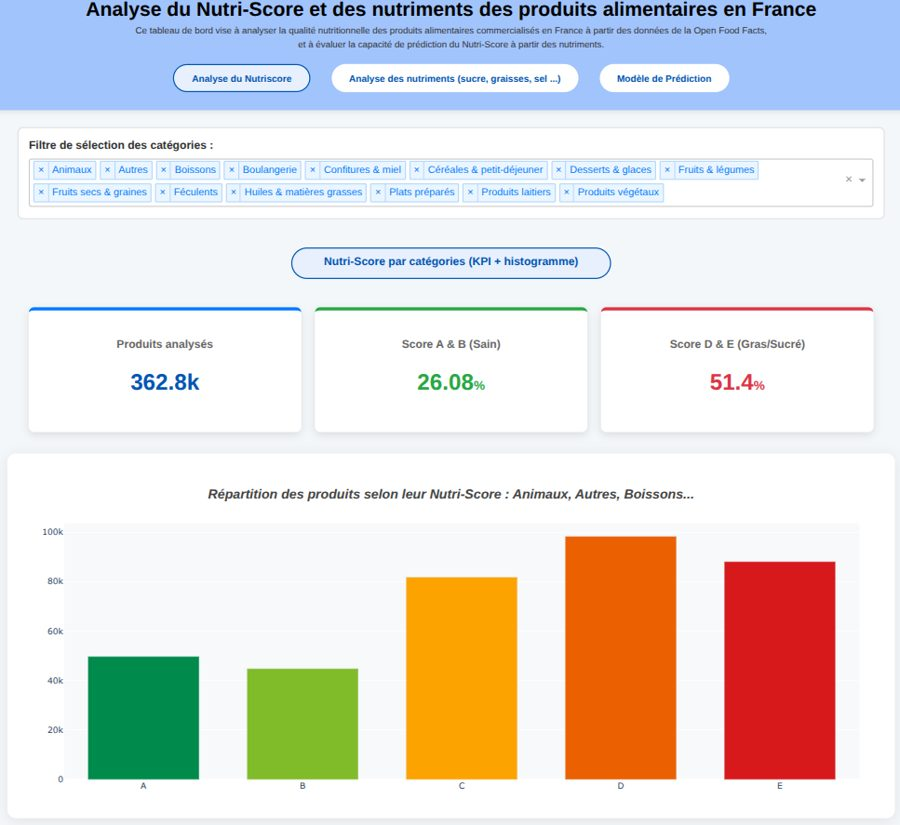
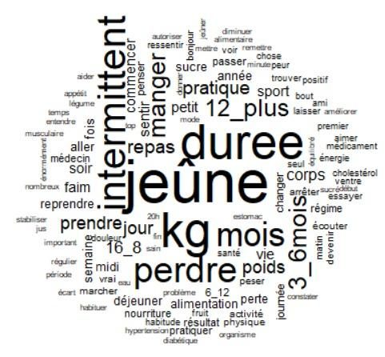
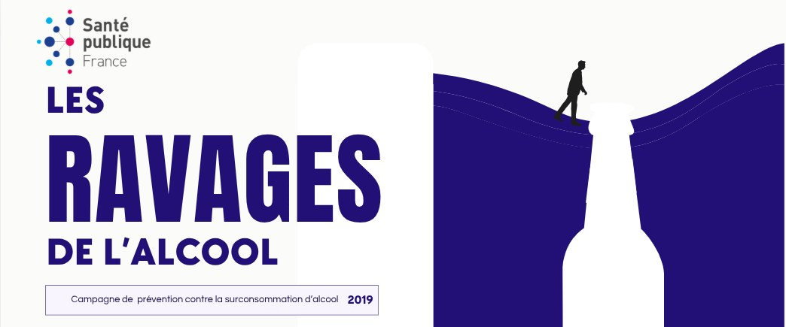
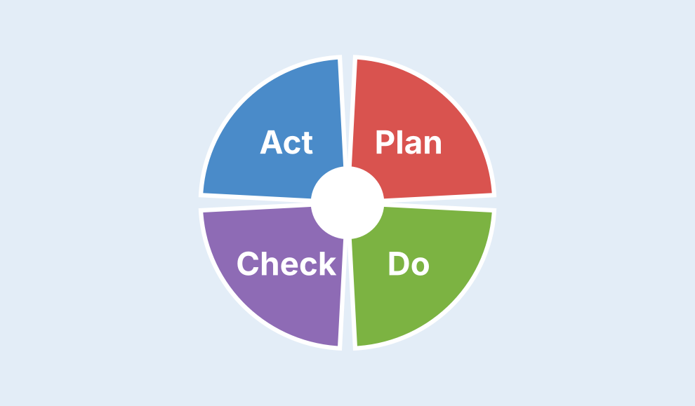

# Projets

[Du plus récent au plus ancien.]{.discret}

::: grille
::: {.carte}
[Mars – août 2026]{.date}

### Prédiction des temps d'attente aux urgences

Stage AHNAC : modèles de prédiction et tableau de bord R Shiny pour 3 hôpitaux.

[R]{.pastille} [SQL]{.pastille} [Machine learning]{.pastille} [R Shiny]{.pastille} [CRISP-DM]{.pastille}

{.photo fig-alt="Écran du tableau de bord affiché en salle d'attente"}

[Voir le détail →](stage-ahnac.qmd){.lien .lien-carte}
:::

::: {.carte}
[2026 – en cours]{.date}

### Mémoire : analyse temporelle des hospitalisations pour tentatives de suicide en lien avec les conditions météorologiques

Mémoire de Master 2, à partir des données du SNDS et de Météo-France.

[SNDS]{.pastille} [Météo-France]{.pastille} [Séries temporelles]{.pastille}

::: logos-ligne
{fig-alt="Logo SNDS"}
{fig-alt="Logo Météo-France"}
:::

[Voir le détail →](memoire.qmd){.lien .lien-carte}
:::

::: {.carte}
[2026 · Projet de groupe]{.date}

### Analyse du Nutri-Score et des nutriments des produits alimentaires en France

Projet de groupe (5 étudiants) : analyse des nutriments à partir d'Open Food Facts et tableau de bord interactif.

[Python]{.pastille} [Dash]{.pastille} [Plotly]{.pastille} [Régression logistique]{.pastille} [Nettoyage de données]{.pastille}

{.photo fig-alt="Tableau de bord Nutri-Score"}

[Voir le détail →](nutri-score.qmd){.lien .lien-carte}
:::

::: {.carte}
[Avril – juin 2025]{.date}

### Stage Qualité : EHPAD Les Ogiers

Préparation de l'évaluation externe HAS : suivi du plan d'action et entretiens de 130 questions menés avec les résidents sur plusieurs séances.

[Entretiens]{.pastille} [Audit qualité]{.pastille} [Référentiel HAS]{.pastille} [AGEVAL]{.pastille}

{.photo fig-alt="Illustration : liste de contrôle et bulles de dialogue"}

[Voir le détail →](stage-ehpad.qmd){.lien .lien-carte}
:::

::: {.carte}
[2024 – 2025 · Projet de groupe]{.date}

### Le jeûne intermittent : témoignages sur les réseaux sociaux et littérature scientifique

Projet de groupe (4 étudiants) : analyse textuelle de 56 témoignages avec IRaMuTeQ.

[IRaMuTeQ]{.pastille} [Analyse textuelle]{.pastille} [Collecte de données]{.pastille}

{.photo fig-alt="Nuage de mots"}

[Voir le détail →](jeune-intermittent.qmd){.lien .lien-carte}
:::

::: {.carte}
[2024 – 2025 · Projet de groupe]{.date}

### Analyse d'une campagne de prévention contre les ravages de l'alcool

Projet de groupe (4 étudiants) : analyse de la campagne « Ravages » de Santé publique France et propositions pour renforcer son impact.

[Santé publique]{.pastille} [Prévention]{.pastille} [Analyse critique]{.pastille} [Analyse SWOT]{.pastille}

{.photo fig-alt="Campagne Les ravages de l'alcool, Santé publique France, 2019"}

[Voir le détail →](campagne-alcool.qmd){.lien .lien-carte}
:::

::: {.carte}
[Octobre – décembre 2024]{.date}

### Stage Qualité : SMR pédiatrique Marc Sautelet

Semaine de la sécurité du patient, audit sur le port du bracelet d'identification (méthode PDCA) et refonte des cahiers de traçabilité.

[Audit PDCA]{.pastille} [Ishikawa]{.pastille} [Excel]{.pastille} [Sensibilisation]{.pastille}

{.photo fig-alt="Illustration : cycle PDCA (Plan, Do, Check, Act)"}

[Voir le détail →](stage-smr.qmd){.lien .lien-carte}
:::
:::
