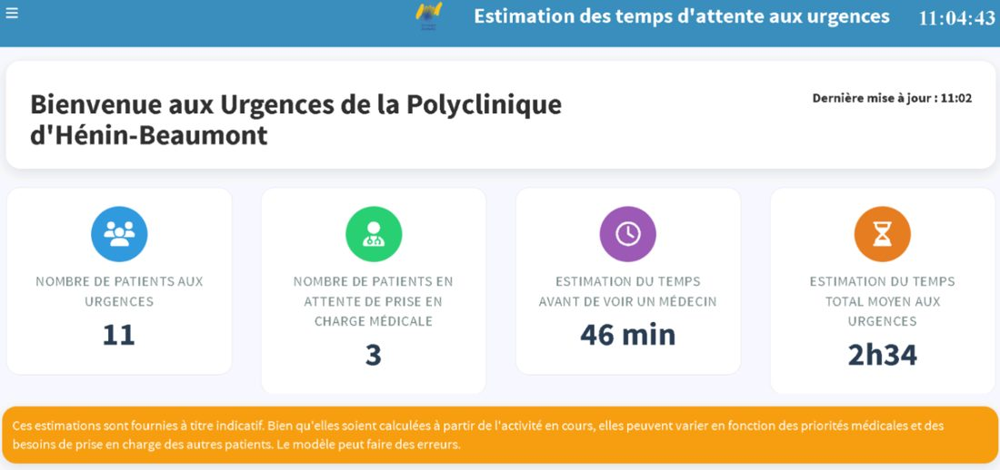
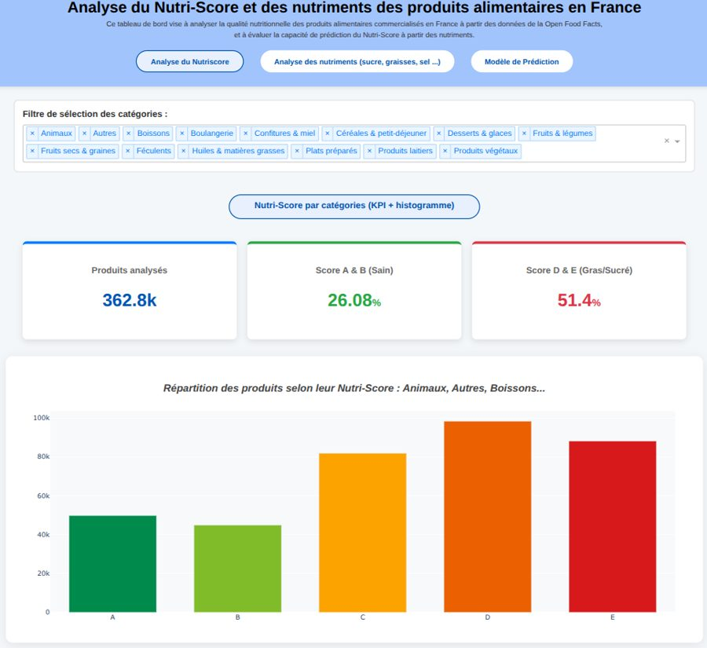
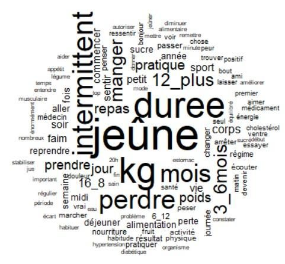

# Projets

[Du plus récent au plus ancien.]{.discret}

::: grille
::: {.carte}
[Mars – août 2026]{.date}

### Prédiction des temps d'attente aux urgences

Stage AHNAC : modèles de prédiction et tableau de bord R Shiny pour 3 hôpitaux.

[R]{.pastille} [SQL]{.pastille} [Machine learning]{.pastille} [R Shiny]{.pastille} [CRISP-DM]{.pastille}

{.photo fig-alt="Écran du tableau de bord affiché en salle d'attente"}

[Voir le détail →](stage-ahnac.qmd){.lien .lien-carte}
:::

::: {.carte}
[2026 – en cours]{.date}

### Mémoire : analyse temporelle des hospitalisations pour tentatives de suicide en lien avec les conditions météorologiques

Mémoire de Master 2, à partir des données du SNDS et de Météo-France.

[SNDS]{.pastille} [Météo-France]{.pastille} [Séries temporelles]{.pastille}

::: logos-ligne
{fig-alt="Logo SNDS"}
{fig-alt="Logo Météo-France"}
:::

[Voir le détail →](memoire.qmd){.lien .lien-carte}
:::

::: {.carte}
[2026 · Projet de groupe]{.date}

### Analyse du Nutri-Score et des nutriments des produits alimentaires en France

Projet de groupe (5 étudiants) : analyse des nutriments à partir d'Open Food Facts et tableau de bord interactif.

[Python]{.pastille} [Dash]{.pastille} [Plotly]{.pastille} [Régression logistique]{.pastille} [Nettoyage de données]{.pastille}

{.photo fig-alt="Tableau de bord Nutri-Score"}

[Voir le détail →](nutri-score.qmd){.lien .lien-carte}
:::

::: {.carte}
[2024 – 2025 · Projet de groupe]{.date}

### Le jeûne intermittent : témoignages sur les réseaux sociaux et littérature scientifique

Projet de groupe (4 étudiants) : analyse textuelle de 56 témoignages avec IRaMuTeQ.

[IRaMuTeQ]{.pastille} [Analyse textuelle]{.pastille} [Collecte de données]{.pastille}

{.photo fig-alt="Nuage de mots"}

[Voir le détail →](jeune-intermittent.qmd){.lien .lien-carte}
:::
:::
