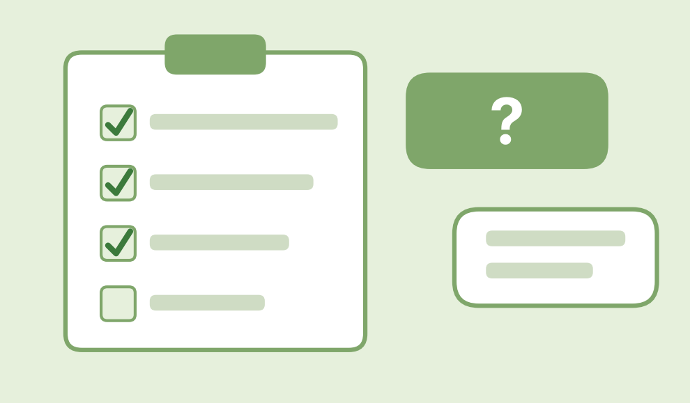
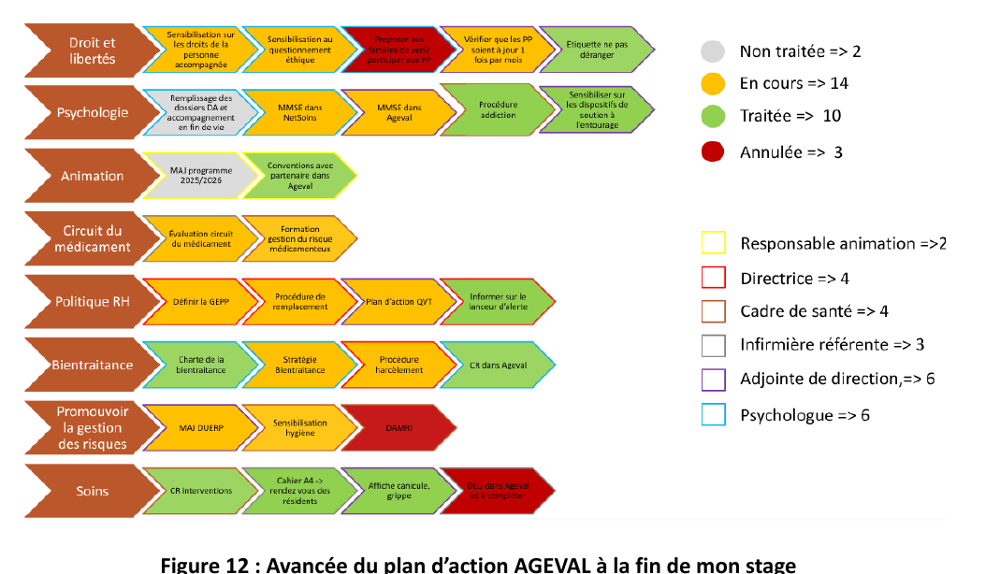
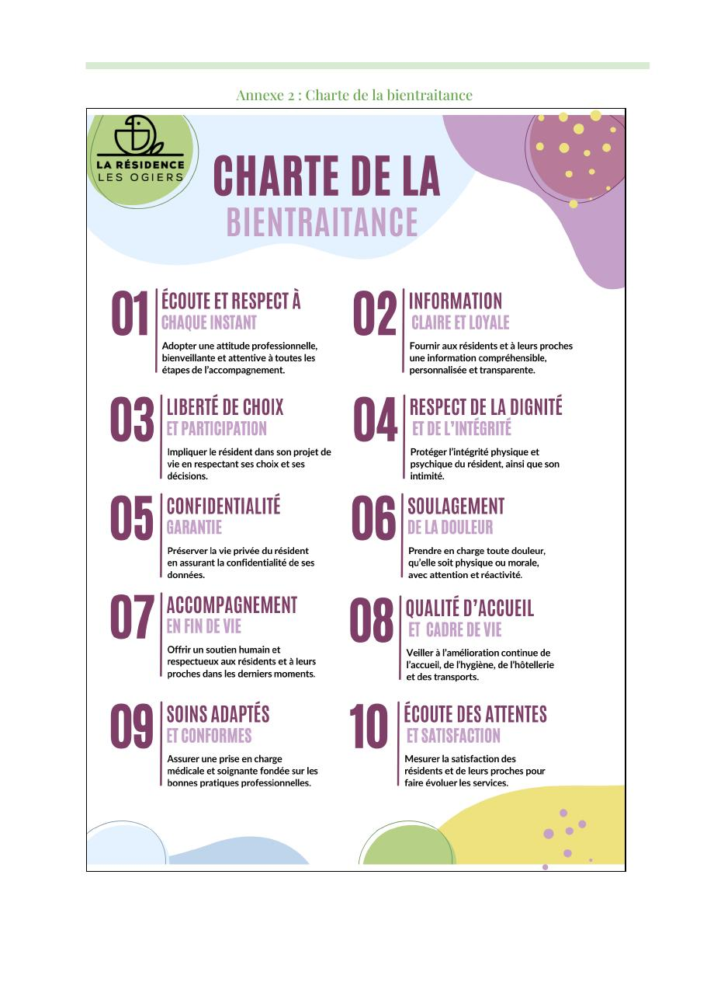

[Avril – juin 2025 · 8 semaines · Licence 3 Sciences sanitaires et sociales (SPMOS)]{.date}

# Stage Qualité · EHPAD Les Ogiers

Préparation de l'évaluation externe de la Haute Autorité de Santé (HAS) dans un EHPAD public de 90 places (Croix, Nord) : suivi du plan d'action qualité, sensibilisation des équipes et entretiens d'audit avec les résidents.

[Entretiens]{.pastille} [Audit qualité]{.pastille} [Référentiel HAS]{.pastille} [AGEVAL]{.pastille} [Gestion de projet]{.pastille} [Canva]{.pastille} [Kahoot]{.pastille} [Excel]{.pastille}

{.photo fig-alt="Illustration : liste de contrôle et bulles de dialogue"}

## Contexte

L'établissement, d'une cinquantaine de professionnels, n'a pas de poste de responsable qualité à temps plein : la mission est portée par l'adjointe de direction, qui était ma tutrice. L'évaluation externe, réalisée par un organisme agréé HAS, était prévue du 8 au 10 juillet 2025. Elle s'appuie sur un référentiel national en trois chapitres : la personne accompagnée, les professionnels et l'établissement. Mon rôle : appuyer l'équipe pour préparer cette évaluation.

## Mes missions

1. **Suivre le plan d'action** dans le logiciel qualité AGEVAL.
2. **Sensibiliser les professionnels** à l'évaluation.
3. **Réaliser les audits exploratoires** du chapitre « La personne » (résidents et Conseil de la vie sociale).
4. **Intégrer les documents qualité** de l'établissement dans AGEVAL.

## Focus : entretiens de 130 questions avec les résidents

::: {.carte .grande}
[Audit exploratoire · chapitre « La personne »]{.date}

Ce chapitre du référentiel HAS compte **29 critères, 61 éléments d'évaluation et 130 questions** (certaines sont conditionnelles, ce qui raccourcit un peu l'entretien). Il fallait les poser à des résidents, un par un, pour mesurer leur connaissance de leurs droits et leur ressenti.

**Ce que j'ai constaté sur le terrain :** la durée prévue (30 à 45 minutes) était très largement sous-estimée. Nous avons donc adapté la méthode :

- **2 à 6 séances par résident**, d'environ 1 heure en moyenne, plus longues et espacées ou plus courtes et fréquentes selon la préférence de chacun ;
- **consentement** recueilli pour l'audit final, avec possibilité d'interrompre la séance à tout moment ;
- **reformulation** des questions en cas de difficulté de compréhension, répétitions en cas de troubles de l'audition ou de l'élocution ;
- **retranscription** de chaque entretien, puis **saisie manuelle** dans le module « Audit » d'AGEVAL et cotation selon les critères HAS.

**Périmètre :** 6 résidents rencontrés (5 sur l'intégralité de l'entretien) et 3 membres du Conseil de la vie sociale. Pour les deux résidents ajoutés en cours de route, les premiers retours étant très similaires, nous avons choisi de ne pas refaire d'entretien complet et de les rencontrer individuellement pour leur présenter la démarche.
:::

**Résultats.** Les résidents se disent globalement satisfaits des équipes. Le point faible : l'information sur leurs droits, avec des supports présents (chartes dans les chambres, à l'entrée) mais rarement consultés, parfois égarés. Après présentation au comité de pilotage, deux actions ont été décidées : des **chartes des droits et libertés en format miniature dans chaque chambre** et des **notes d'information individuelles enrichies** (personne de confiance, droit de vote, CVS, commissions).

## Suivi du plan d'action AGEVAL

Le plan comptait **8 actions principales et 29 sous-actions** réparties entre 6 pilotes. À mon arrivée, aucune n'était traitée. J'ai contacté chaque pilote, relancé, et aidé à produire certains livrables. Bilan en fin de stage : **10 traitées, 14 en cours, 2 non traitées, 3 annulées**.

{.photo fig-alt="Avancement du plan d'action AGEVAL à la fin du stage"}

## Sensibilisation et supports

- Charte de la bientraitance (affichée à 4 endroits), quiz Kahoot de 14 questions, 60 accroche-portes « Ne pas déranger », 5 infographies sur les aidants, notes sur le statut de lanceur d'alerte et sur les épisodes canicule et grippe.
- Préparation logistique de l'audit : 2 réunions du comité de pilotage qualité, planning des entretiens, documents à déposer pour l'organisme évaluateur.
- Pour les équipes : **25 notes d'information individuelles**, **30 carnets mémo** plastifiés, un classeur qualité et 2 temps d'échange en salle de transmission (environ 20 soignants touchés).

{.photo fig-alt="Charte de la bientraitance réalisée pendant le stage"}

## Gestion documentaire

**265 documents qualité** (processus management, réalisation et support) migrés du serveur interne vers AGEVAL, en recréant l'arborescence à l'identique. J'ai créé des mots-clés par fonction professionnelle (« aide-soignante », « infirmière »…) pour faciliter la recherche, puis ajouté une vingtaine de documents pour la préparation de l'évaluation.

## Limites et enseignements

- Certaines actions n'ont pas pu être finalisées dans le temps du stage, notamment le document d'analyse du risque infectieux (DAMRI), trop transversal pour être mobilisé dans les délais.
- Beaucoup d'actions (formalisation de la GEPP, mise à jour du DUERP…) étaient encore en cours en fin de stage, et ont été reprises par ma tutrice.
- Une légère réticence initiale de certains professionnels n'ayant jamais connu d'évaluation externe, levée par les échanges en salle de transmission et par la clarté des supports.

## Ce que j'en retiens

Conduire des entretiens longs et structurés auprès de personnes fragiles, adapter un protocole au terrain, saisir et coter des données de façon rigoureuse, puis les restituer à un comité de pilotage pour décider d'actions concrètes.

[← Retour aux projets](projets.qmd){.bouton .contour}
