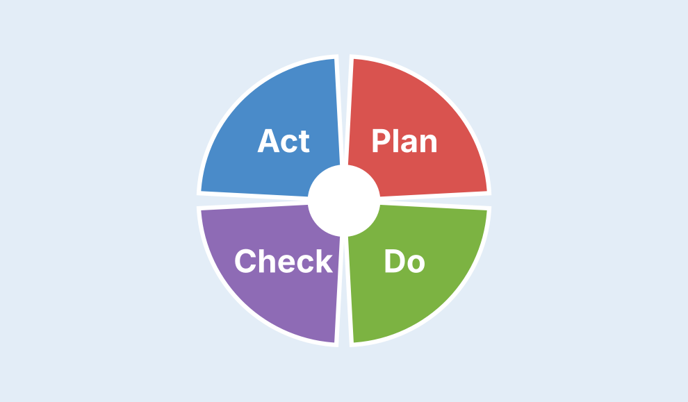
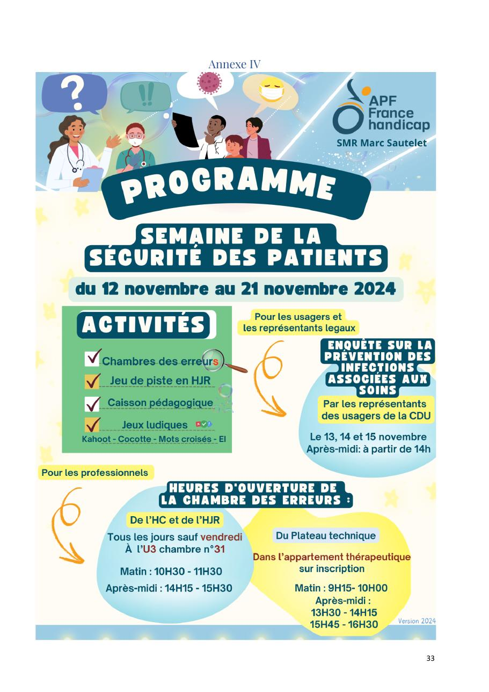
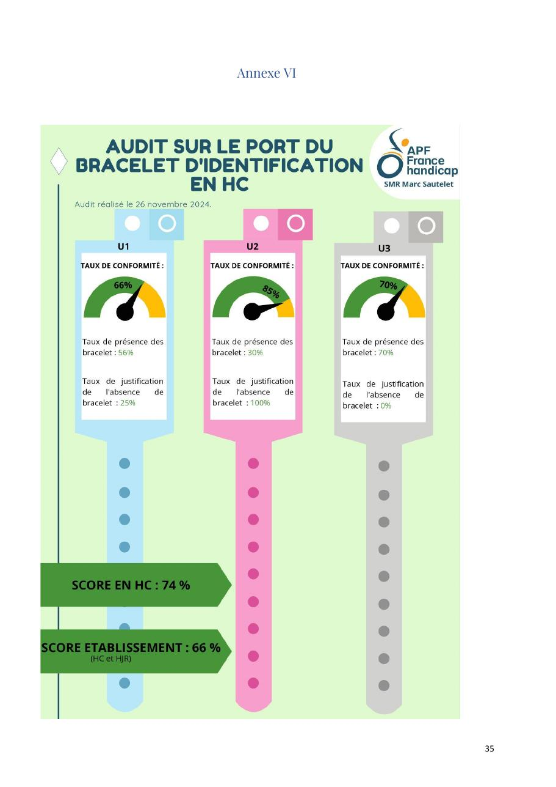

[Octobre – décembre 2024 · Licence 3 Sciences sanitaires et sociales (SPMOS)]{.date}

# Stage Qualité · SMR pédiatrique Marc Sautelet

Démarche qualité d'un établissement de soins médicaux et de réadaptation pour enfants (Villeneuve-d'Ascq) en vue de la certification HAS de 2025 : organisation de la Semaine de la sécurité du patient, audit sur le port du bracelet d'identification et amélioration des cahiers de traçabilité.

[Audit PDCA]{.pastille} [Ishikawa]{.pastille} [Excel]{.pastille} [Analyse de données]{.pastille} [Sensibilisation]{.pastille} [Canva]{.pastille} [Kahoot]{.pastille}

{.photo fig-alt="Illustration : cycle PDCA (Plan, Do, Check, Act)"}

## Contexte

Établissement privé d'intérêt collectif créé par l'APF France Handicap, avec 64 lits d'hospitalisation complète et 36 places d'hospitalisation de jour. Il vise le niveau « Haute qualité des soins » à la certification de 2025. J'étais intégrée à l'équipe qualité (responsable qualité, assistante qualité et une autre stagiaire).

## Mission principale : Semaine de la sécurité du patient (12-21 novembre 2024)

Organisation en trois phases : préparation, animation, analyse.

- **Chambres des erreurs** : 12 erreurs en hospitalisation complète, 11 au plateau technique, avec correction collective en fin de séance.
- **Animations** : jeu de piste « Les super-héros de la santé » en hôpital de jour (9 affiches), jeu de cocottes en papier, chronomètre « événements indésirables », stand de friction des mains avec caisson pédagogique.
- **Analyse** : **67 participants** sur une trentaine de séances. Calcul sous Excel du taux d'identification de chaque erreur, puis restitution en diaporama.

{.photo fig-alt="Programme de la Semaine de la sécurité des patients, novembre 2024"}

## Audit sur le port du bracelet d'identification

Audit d'observation mené selon le cycle **PDCA** : méthodologie validée, observation sur le terrain, calcul des taux de conformité, puis analyse des causes et plan d'actions.

::: grille
::: {.carte}
[Hospitalisation complète]{.date}

### 74 % de conformité

29 enfants observés, dans 3 unités.
:::

::: {.carte}
[Hospitalisation de jour]{.date}

### 92 % de conformité

12 enfants observés.
:::
:::

L'analyse des causes (**diagramme d'Ishikawa**) a conduit à **5 actions correctives**, centrées sur la sensibilisation des adolescents (qui retirent parfois leur bracelet) et les bonnes pratiques des équipes.

**Limite :** effectifs faibles (créneaux d'observation peu adaptés : marche nordique, siestes), donc des résultats à interpréter avec prudence. Pour les prochains audits, j'ai recommandé de planifier les observations quand le plus d'enfants sont présents.

{.photo fig-alt="Restitution de l'audit sur le port du bracelet en hospitalisation complète"}

## Cahiers de traçabilité et gestion documentaire

- **Bio-nettoyage** : la grille ne permettait pas de suivre toutes les fréquences du protocole (par exemple un balayage humide quatre fois par jour pour une seule case). Refonte avec l'infirmière hygiéniste, **16 indicateurs** adaptés.
- **99 cahiers de traçabilité 2025** imprimés et reliés, avec un tableau Excel de suivi que j'ai conçu.
- **Étiquettes** pour les poches de perfusion (deux versions, après retours des infirmières) et pour les médicaments à risque (trois formats).
- Saisie de **25 questionnaires de satisfaction** sur l'hygiène dans un fichier Excel pour analyse.

## Limites et enseignements

Le quiz Kahoot et les mots croisés n'ont pas pu être utilisés pendant la semaine, faute de temps pour faire valider les contenus par des pairs. Retour d'expérience : faire valider les questions avant la mise en forme et planifier de façon plus réaliste.

## Ce que j'en retiens

Mener un audit de bout en bout (méthodologie, collecte, calcul des indicateurs, analyse des causes, plan d'actions), concevoir des outils de suivi sous Excel, et animer des sessions de sensibilisation auprès de soignants.

[← Retour aux projets](projets.qmd){.bouton .contour}
